# 物理实验室 Spatial · Physics Lab Spatial

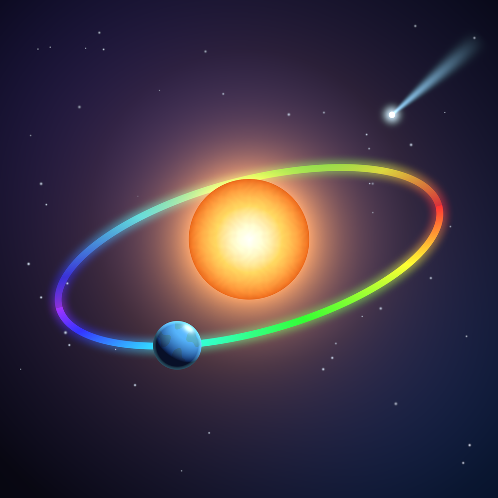

18 个物理与化学实验，做成可以**亲手操作**的空间实验台，运行在 PICO 头显（Swan）的 Shared Space 中。
化学实验采用「宏观现象 + 微观分子」并排呈现。基于 PICO SpatialSDK（Kotlin + Compose）开发；中英双语界面。

*18 physics and chemistry experiments as hands-on spatial lab benches for PICO (Swan) Shared Space —
chemistry shows the macroscopic phenomenon next to the molecules doing it. Built with PICO SpatialSDK
(Kotlin + Compose). Chinese / English UI.*

| | |
|---|---|
| 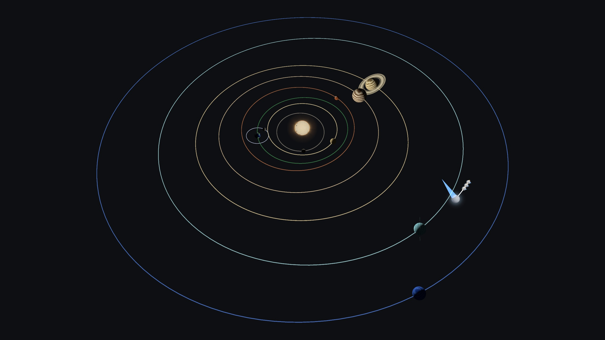 | 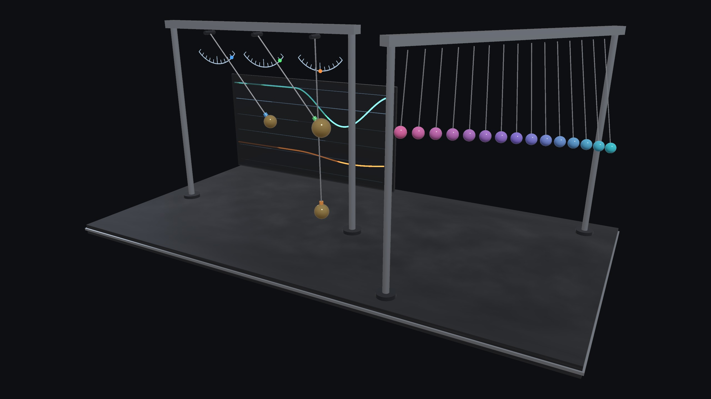 |
| 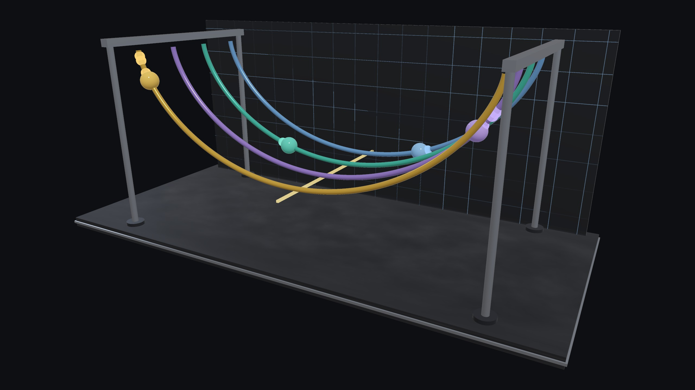 | 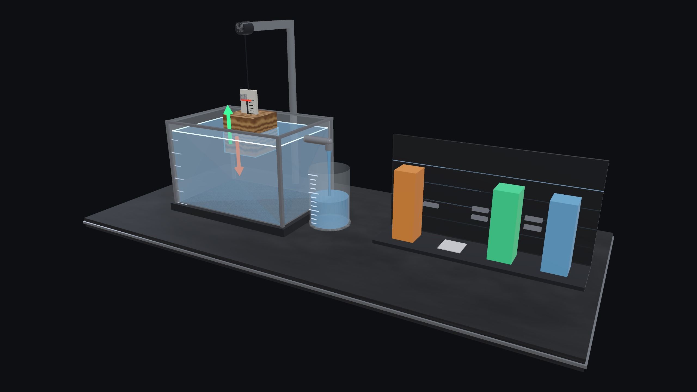 |
| 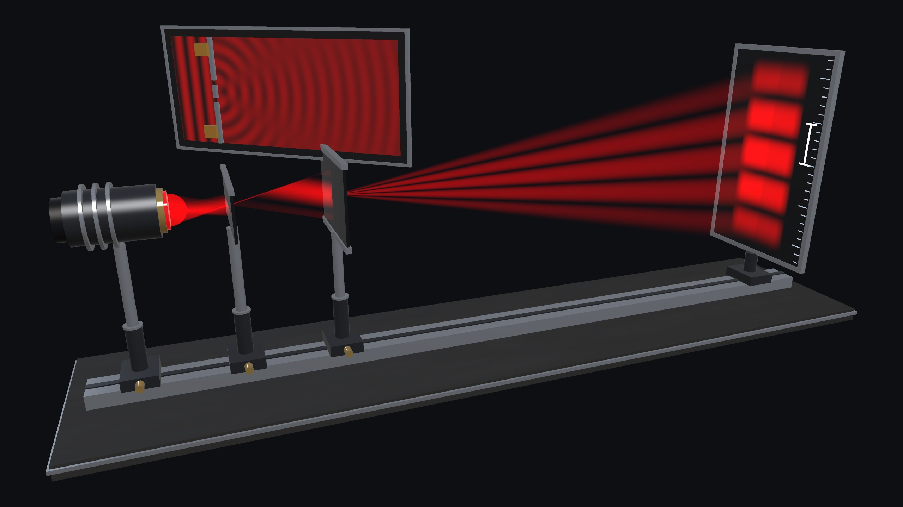 | 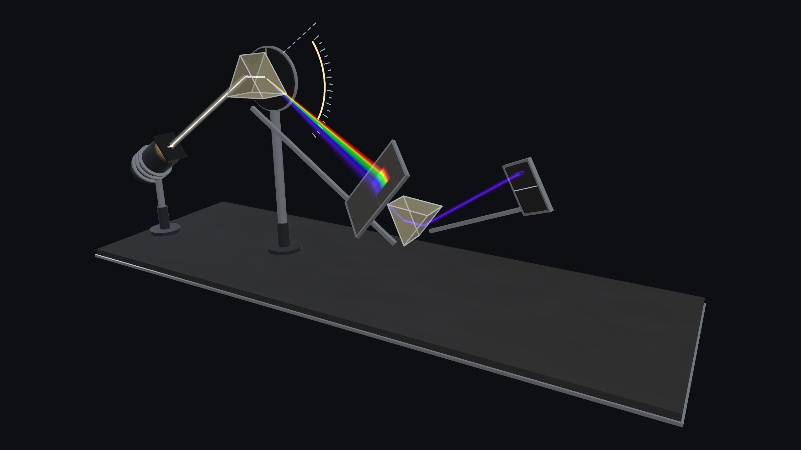 |
| 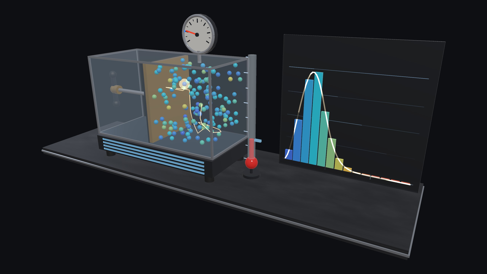 | 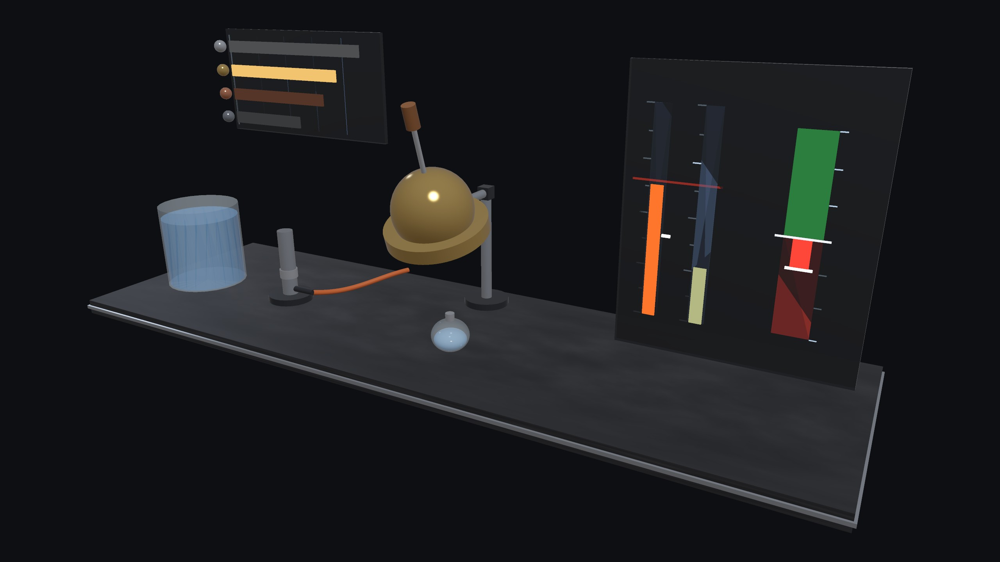 |
| 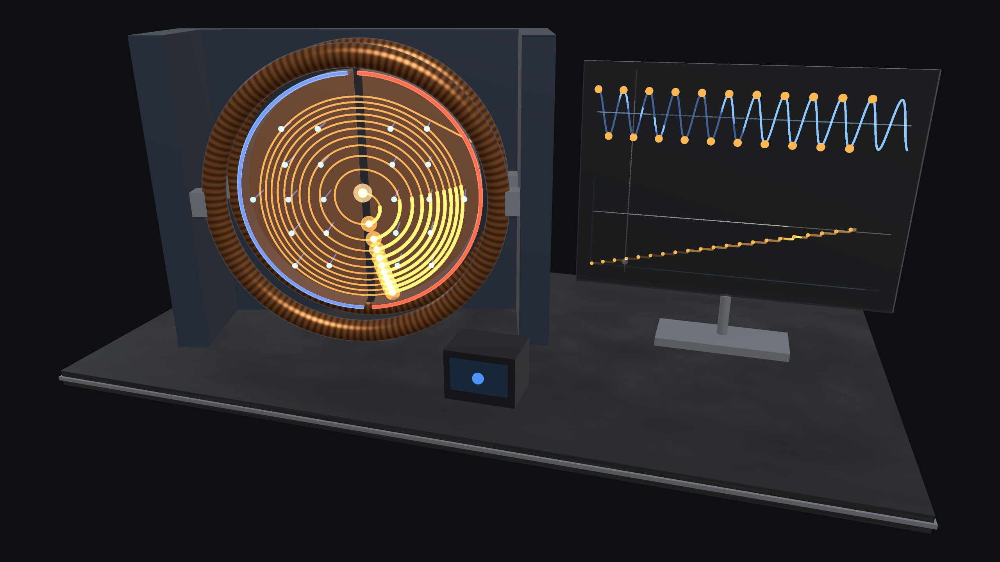 | 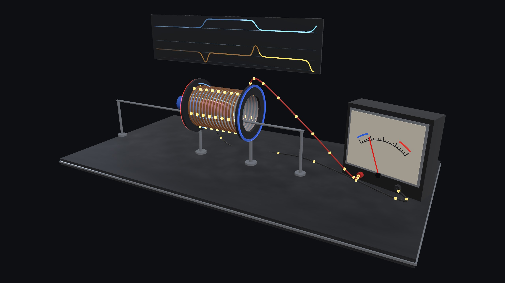 |
| 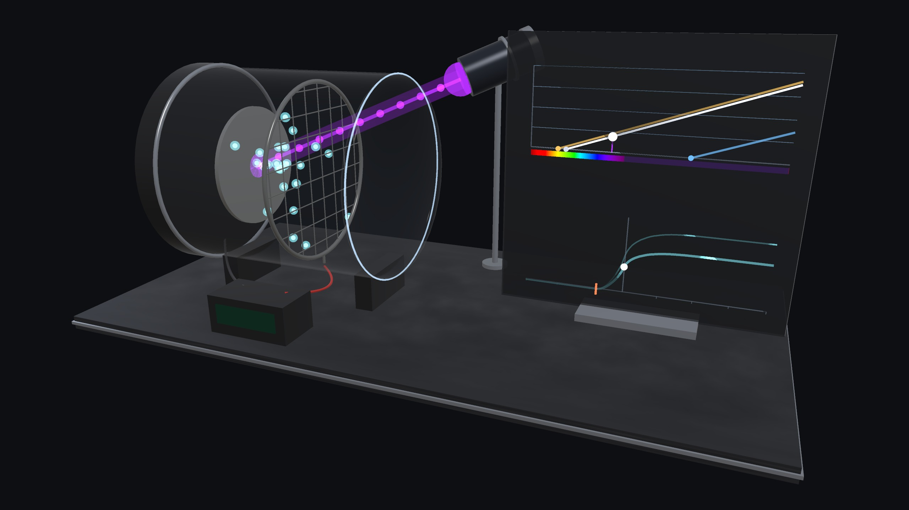 | 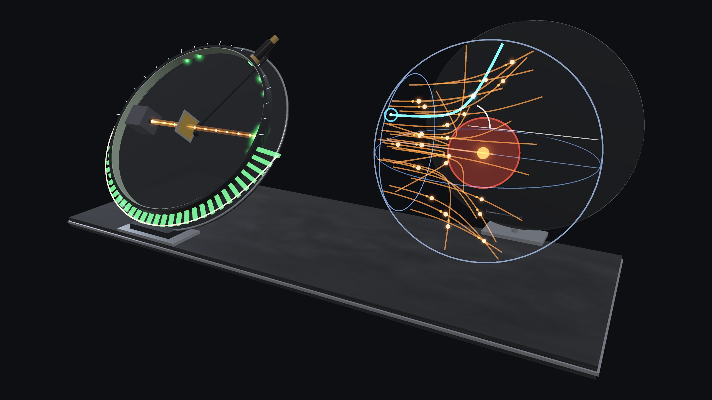 |
| 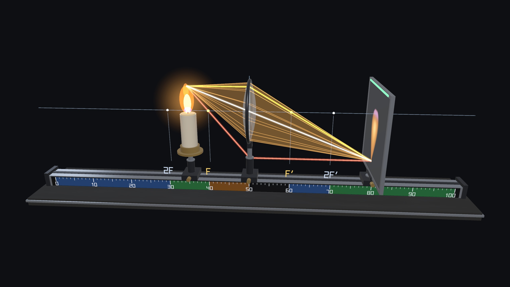 | 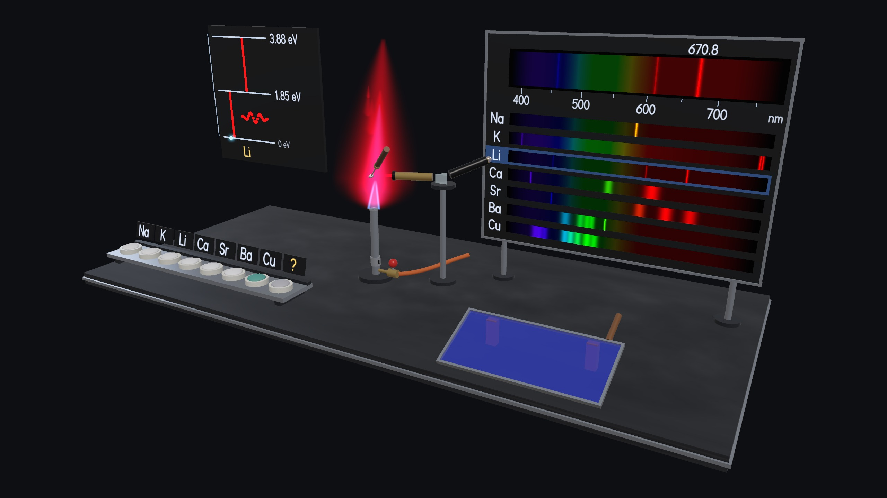 |
| 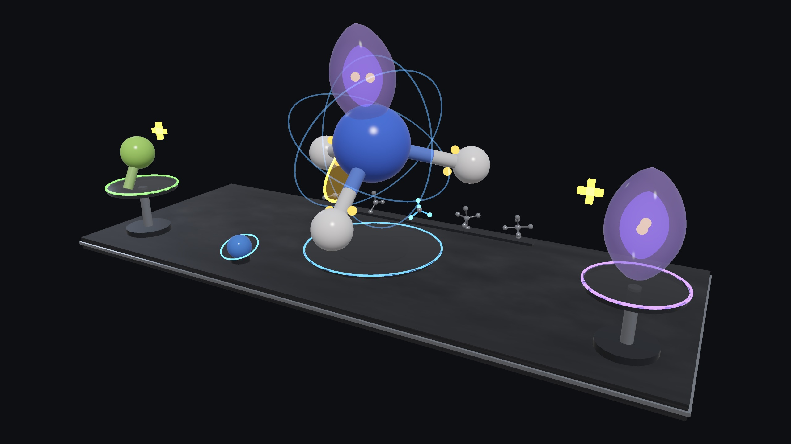 |  |
| 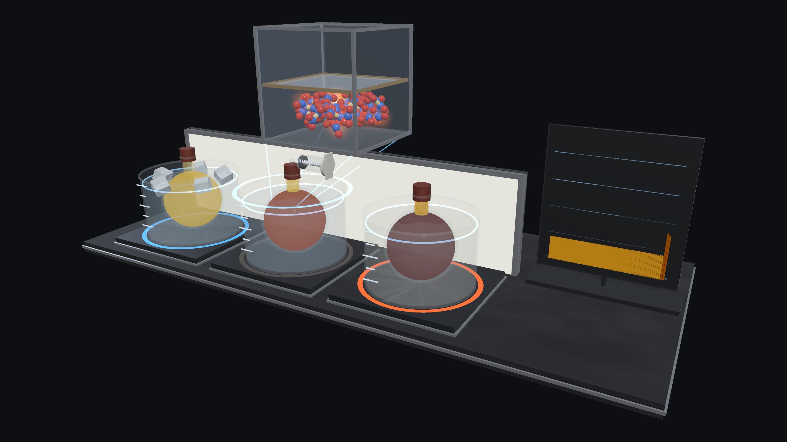 |  |

*截图为 2560×1440 无头渲染（`ShowcaseRenderTest`），与头显内的场景同源。
HD stills rendered headlessly from the same scene code that runs on the headset.*

## 实验 · Experiments

| 实验 | Experiment | 你可以做什么 · What you do |
|---|---|---|
| 太阳系 · 开普勒定律（Kepler 1609） | Solar System · Kepler's Laws | 捏行星看开普勒数据卡；**用手把彗星抛进太阳系**，轨道由手速决定 · Pinch a planet for its Kepler card; *throw a comet* — your hand speed sets the orbit |
| 伽利略单摆（1602） | Galileo's Pendulum | 换释放角，看大角度下等时性如何失效（精确解，非小角近似）· Exact large-angle motion, not the small-angle formula |
| 最速降线（Bernoulli 1696） | Brachistochrone | 先猜哪颗珠子最快，再看比赛 · Guess first, then race four beads |
| 阿基米德浮力 | Archimedes' Buoyancy | 放入物块，看秤读数与溢出水量 · Lower a block, weigh the overflow |
| 杨氏双缝干涉（1801） | Young's Double Slit | 遮缝、换波长与屏距 · Cover a slit, change λ and L |
| 牛顿棱镜色散（1666） | Newton's Prism | 换玻璃、转棱镜、判决性实验 · Glass, minimum deviation, experimentum crucis |
| 气体分子运动论（Boltzmann 1872） | Kinetic Theory of Gases | 推活塞、加热，看麦克斯韦分布 · Piston, heater, Maxwell distribution |
| 热胀冷缩 · 铜球与环（'s Gravesande 1720） | Thermal Expansion · Ball & Ring | 烧球、烧环、试穿 · Heat the ball or the ring, try it |
| 回旋加速器 · 洛伦兹力（Lawrence 1932） | Cyclotron · Lorentz Force | 换粒子、调磁场与射频 · Particle, B field, RF tuning |
| 法拉第电磁感应（1831） | Faraday's Induction | 翻转磁铁、换匝数 · Flip the magnet, change the turns |
| 光电效应（Einstein 1905） | Photoelectric Effect | 换谱线、换金属、调电压 · Spectral line, metal, voltage |
| α 粒子散射（Rutherford 1911） | Alpha Scattering · the Nucleus | 转动显微镜计数、瞄准原子核看双曲线轨迹、切换汤姆孙模型对比 · Swing the counter, aim at the nucleus, compare with Thomson's model |
| 凸透镜成像（Kepler 1611） | Convex Lens Imaging | 拖动蜡烛和光屏，3D 光路实时会聚成像（实像 / 虚像）· Drag candle and screen; rays converge in 3-D |
| **化学 · Chemistry** | | |
| 焰色反应与原子光谱（Bunsen & Kirchhoff 1860） | Flame Tests & Atomic Spectra | 蘸盐看火焰颜色与谱线、钴玻璃、猜未知盐 · Dip salts, read the lines, cobalt glass, identify the unknown |
| 分子构型 · VSEPR（Gillespie–Nyholm 1957） | Molecular Shapes · VSEPR | 添加成键 / 孤对电子，分子自己「长」成正确形状 · Add bonds or lone pairs; the shape self-assembles |
| 电解水（Nicholson & Carlisle 1800） | Electrolysis of Water | 调电压、加电解质，H₂ : O₂ = 2 : 1，检验两种气体 · Voltage, electrolyte, the 2 : 1 gases, gas tests |
| 化学平衡 · 勒夏特列（Le Chatelier 1884） | Chemical Equilibrium | 冷热水浴与压缩，NO₂⇌N₂O₄ 颜色与分子比例同步变化 · Heat, cool, compress; colour and molecule ratio change together |
| 大象牙膏 · 催化分解 | Elephant Toothpaste · Catalysis | 换催化剂与浓度，泡沫喷发、碘离子循环、木条复燃 · Catalysts and concentrations; the eruption, the I⁻ cycle, the glowing splint |

## 交互 · Interaction

- **注视 + 捏合**：每个可捏的物体有呼吸光圈；捏中时光圈闪一下，物体上方显示「刚才发生了什么」。
  *Gaze + pinch: pinchable objects have a breathing ring; every pinch flashes it and says what it did.*
- 每个可捏物体在控制面板上都有同名按钮（「物体 → 动作」），两边状态同步。
  *Every pinchable object has a twin button on the panel ("object → action"), kept in sync.*
- 顶栏：实验目录 / 上一个 / 下一个 / 中英切换。
  *Top bar: catalogue, previous / next, language toggle.*

## 物理 · Physics

物理核心是纯 Kotlin（`app/src/main/java/.../core/`），并用 JVM 测试核对真实数值：
- 单摆：Jacobi 椭圆函数精确解；
- 行星：JPL 近似星历；
- 彗星：蛙跳积分，一年漂移小于 1e-5；
- 其余：守恒律与教科书数值。

*Physics cores are plain Kotlin, checked by JVM tests against real numbers: the exact pendulum (Jacobi sn), JPL approximate ephemerides, a leapfrog comet integrator (drift below 1e-5 per year), conservation laws and textbook values.*

## 构建 · Build

要求 · Requirements：
- JDK 17
- Android SDK 35
- 联网拉取 PICO SpatialSDK 0.13.3（Volcengine Maven，已在 `settings.gradle.kts` 中配置）· *network access for PICO SpatialSDK 0.13.3 (Volcengine Maven, configured in `settings.gradle.kts`)*

```bash
./gradlew :app:testDebugUnitTest     # ~200 JVM tests: physics, scene contracts, headless render & UI review
./gradlew :app:assembleDebug         # app/build/outputs/apk/debug/app-debug.apk
adb install -r app/build/outputs/apk/debug/app-debug.apk
```

无头评审 · Headless review：
- `LabReviewTest`：用 CPU 渲染每个实验场景，输出到 `app/build/review/`。*Renders every scene on the CPU.*
- `UiPreviewTest`：用 Robolectric 渲染真实的 Compose 面板（中英双语），并检查排版。*Renders the real Compose panels in both languages and checks the layout.*
- `ShowcaseRenderTest`（`-Dshowcase=true`）：输出 2560×1440 高清截图到 `app/build/showcase/`。*HD stills.*
- `python3 tools/make_icons.py` / `tools/make_poster.py`：生成图标（含 PICO 3D 图标的各层）与宣传海报，输出到 `docs/store/`。*Icon (incl. PICO 3-D icon layers) and store poster.*

架构与开发约定见 [AGENTS.md](AGENTS.md)。*Architecture and conventions: see [AGENTS.md](AGENTS.md).*
